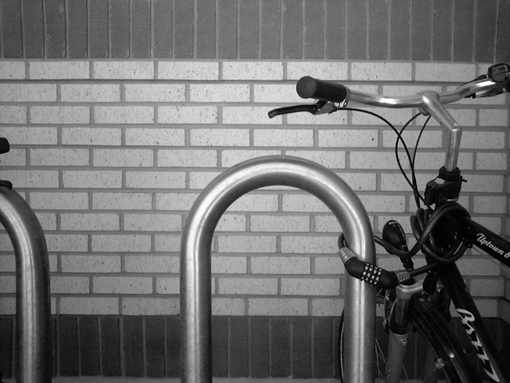

# Detector de bordes Sobel en paralelo

[](https://github.com/Whiteherobot/java-sobel-paralelo/actions/workflows/ci.yml)

Aplica el operador de Sobel a una imagen de dos formas, secuencial y repartiendo franjas de filas
entre varios hilos (`ExecutorService`), y compara los tiempos. Usa solo Java estándar (`ImageIO`).

<p>
  
  
</p>

## Uso

Requiere JDK 17 o superior.

```bash
./mvnw clean verify
java -jar target/java-sobel-paralelo-1.0.0.jar                         # imagen de ejemplo
java -jar target/java-sobel-paralelo-1.0.0.jar foto.jpg salida.png 8   # imagen, salida, hilos
```

Resultados en un i7-13650HX (14 núcleos, 20 hilos lógicos) (promedio de 10 corridas, después de 3 de calentamiento):

| Imagen | Secuencial | Paralelo (20 hilos) | Aceleración |
|---|---|---|---|
| 640×480 (ejemplo) | 4.11 ms | 1.87 ms | 2.2× |
| 9504×6336 (foto de 60 MP) | 373.6 ms | 83.2 ms | 4.5× |

En la imagen chica, crear y coordinar 20 tareas pesa casi tanto como el cálculo. La aceleración
no llega a 20× porque el filtro lee mucha memoria por cada operación, y el ancho de banda de la
RAM se reparte entre todos los núcleos.

## Cómo está hecho

- `Sobel`: convierte la imagen a gris **una sola vez**, en un arreglo plano, y calcula la magnitud
  del gradiente en un rango de filas. En la primera versión cada píxel se convertía a gris nueve
  veces, una por cada vecino de la máscara, y se leía con `getRGB`, que es lento.
- `DetectorBordes`: la versión paralela reparte las filas de forma pareja, aunque el alto no sea
  divisible por el número de hilos, y propaga cualquier excepción de un hilo con `Future.get()`.
  Cada hilo escribe en filas distintas del arreglo de salida, así que no hace falta sincronizar.
- `Main`: mide con calentamiento y verifica que las dos versiones den exactamente el mismo
  resultado.
- Las pruebas (JUnit 5) cubren una imagen uniforme, un escalón con valor conocido, que la versión
  paralela sea idéntica a la secuencial con 1 a 64 hilos, más hilos que filas, y la validación
  de los argumentos.

## Créditos

Imagen de ejemplo: [Bikesgray.jpg](https://commons.wikimedia.org/wiki/File:Bikesgray.jpg), de
Davidwkennedy, licencia [CC BY-SA 3.0](https://creativecommons.org/licenses/by-sa/3.0/). Es la
imagen con la que Wikipedia ilustra el operador de Sobel. `docs/bordes.png` es una obra derivada
y se comparte con la misma licencia.

## Licencia

Código bajo MIT. Ver [LICENSE](LICENSE).
